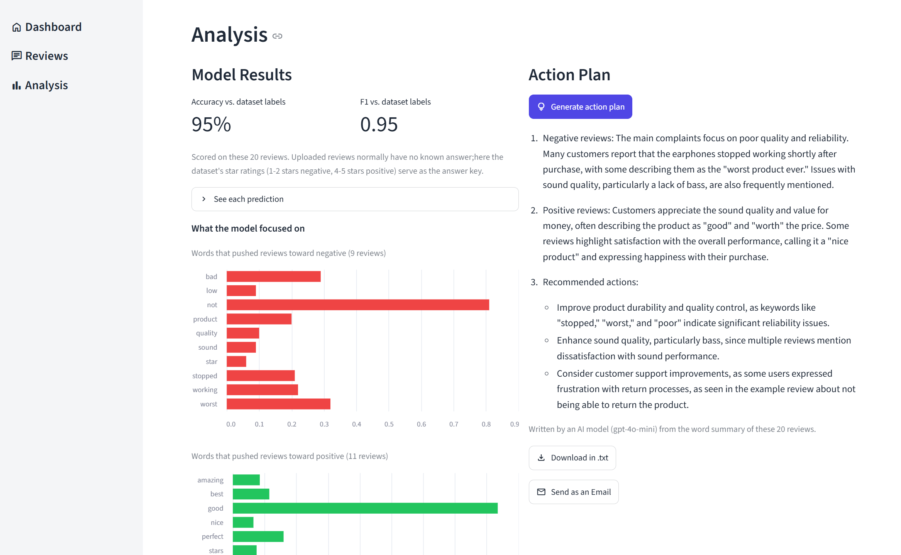

# Customer Review Insights

Turn customer reviews into clear findings and next steps for a product team.

**Live demo:** https://ibrahim-review-insights.streamlit.app/
*(Free hosting: if the app is asleep, press the wake-up button and wait a few seconds.)*



## What it does

1. **Classify** 20 customer reviews of the JBL T110BT earphones as positive or negative.
2. **Explain** the result with SHAP: which words pushed the model toward each class.
3. **Recommend** actions: an LLM reads the word summary and a fixed business context, then writes a short action plan.

## How it works

- **Data:** 1,610 JBL T110BT reviews from the [Kaggle Amazon Earphones Reviews](https://www.kaggle.com/datasets/shitalkat/amazonearphonesreviews/data) dataset. 3-star reviews removed; 1-2 stars = negative, 4-5 stars = positive.
- **Model:** DistilBERT fine-tuned for 3 epochs (transfer learning), compared with a TF-IDF + logistic regression baseline.
- **Explainability:** SHAP scores per word, computed offline for the whole test set.
- **LLM:** `gpt-4o-mini` receives the top words per class, their SHAP scores, and a few example reviews.
- The app's "About" sections explain the model and SHAP in more detail.

## Results (242 held-out test reviews)

| Model | Accuracy | F1 |
|---|---|---|
| TF-IDF + Logistic Regression | 92.1% | 0.921 |
| DistilBERT (fine-tuned) | 94.6% | 0.947 |

## Design decisions

- **Predictions and SHAP are precomputed**, so the deployed app is light and fast, and never loads the model.
- **Fixed business context and no uploads**, to prevent misuse of the LLM.
- **Capped LLM spend:** 5 plans per session and a hard monthly limit on the API account.
- **SHAP instead of attention weights**, because attention is a contested way to explain a model's decisions.

## Limitations

- Small, single-product dataset; each demo uses only 20 reviews, so conclusions are indicative.
- Keywords are single words, so negation ("not good") is only visible through the example reviews.
- Labels come from star ratings, which can be noisy. Some review titles (e.g. "Four Stars") repeat the rating.
- "Classify" replays stored predictions rather than running the model live.

## Run locally

```bash
pip install -r requirements-train.txt   # GPU users: install torch from the CUDA index first
python prepare.py                       # data -> train -> evaluate -> SHAP -> artifacts/
# create .streamlit/secrets.toml with:  OPENAI_API_KEY = "sk-..."
pip install -r requirements.txt
streamlit run app.py
```

`prepare.py` expects the dataset CSV at `data/JBL_T110BT_reviews.csv` (not included; see the Kaggle link).